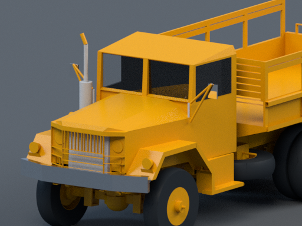

= art rendering demonstrations

The moss comparison uses Gary Moss's original "World on a Platter" example.
Both images were rendered with art at 512 by 384 pixels and 64 samples per
pixel, using the same camera, geometry, instance placements, and three-point
studio lighting at azimuth 35 and elevation 25 degrees.  The original
database remains the input to both versions.

* `moss-before.png` uses the original region colors through art's default
  OSL plastic material.
* `moss-after.png` assigns rough gold to the torus, smooth absorbing glass
  to the ellipsoid, enamel to the box and cone, and dark plastic to the
  platform.  The original region colors still supply the enamel base colors.

The lighting recipe retains `all.g`, including its member transforms.  It
sets the original light's brightness to zero and adds three point lights
inside the original model bounds so automatic framing stays consistent.
The material recipe uses the installed Appleseed shader library.  No custom
shader compiler or external texture assets are required.

== Regeneration

An installation needs art, mged, the Appleseed shader library, and the
standard `share/db/moss.g` example.  From a writable directory, run:

----
cmake -DBRLCAD_PREFIX="${BRLCAD_PREFIX}" -DOUTPUT_DIR=moss-render \
    -P "${BRLCAD_PREFIX}/share/db/art/render_moss.cmake"
----

Use `-DSOURCE_DB=path/to/moss.g` when the example database is elsewhere.
The driver copies the input database before editing it.  Keep `SOURCE_DB`
outside `OUTPUT_DIR`; the generated directory contains replaceable assets
and logs.  This rule applies to every example driver.  Its output
contains two material-ready databases, two PNG images, the resolved
material report, and authoring and rendering logs.  To reopen either
version, select `art.demo.g` in the generated database.

Increase image resolution and sampling for larger illustrations:

----
cmake -DBRLCAD_PREFIX="${BRLCAD_PREFIX}" -DOUTPUT_DIR=moss-large \
    -DWIDTH=1024 -DHEIGHT=768 -DSAMPLES=256 -DWORKERS=4 \
    -P "${BRLCAD_PREFIX}/share/db/art/render_moss.cmake"
----

These previews demonstrate material authoring on an existing CSG model.
They do not qualify general rough glass, overlapping media, or all legacy
optical shader translations.  See the art article for the tested feature
boundaries and the integration roadmap.

== Replacing a legacy sky shell

`star.g` (the Enterprise and shuttlecraft) supplies a worked sky migration.
Its `all` assembly includes `clouds.r`, a very large spherical shell.  The
shell uses a checker shader with both colors set to `0/0/150`: despite its
name, this is a constant-blue backdrop, rather than a procedural cloud sky.

The comparison uses the same subject-framed camera for all three images:

* `star-before.png` uses rt, the original liboptical shaders, the original
  light, and the original shell.
* `star-after.png` uses art, retaining the ship and shuttle instances,
  their transforms and region colors, with a polished OSL plastic surface.
  A blue camera backdrop replaces the shell.  A white environment dome
  supplies neutral illumination and reflections independently of that blue.
  Warm key and cool rim point lights replace the original light's contribution.
* `star-space.png` changes only the camera backdrop to black.  Lighting and
  material settings remain identical to `star-after.png`.

The art images illustrate material, lighting, and background authoring,
without claiming exact translation of liboptical's plastic parameters or
identical shading between rt and art.
The art previews use 512 by 384 pixels and 64 samples per pixel.  Art's
point-light proxy spheres do not appear as visible geometry.
The point-light multiplier is calibrated for this model's millimeter
coordinates; it is not a portable physical intensity for arbitrary models.
The dome intensity is 0.08 and the backdrop multiplier is one.

An installation needs rt and the standard `share/db/star.g` example in
addition to art and mged.  Regenerate from a writable directory:

----
cmake -DBRLCAD_PREFIX="${BRLCAD_PREFIX}" -DOUTPUT_DIR=star-render \
    -P "${BRLCAD_PREFIX}/share/db/art/render_star.cmake"
----

The same `SOURCE_DB`, `WIDTH`, `HEIGHT`, `SAMPLES`, and `WORKERS` options
used by the moss example apply.  The driver copies its input twice and
checks the expected constant-blue shader before modifying the art copy.
It leaves the shell objects available for inspection and excludes them
from the `art.demo.g` render selection.  The before copy retains `all`
unchanged.  Logs, a resolved material/environment report, and a reusable
`star-camera.view` stream accompany the images.  The `star-after.view` and
`star-space.view` streams include the complete camera, sampling, lighting,
and background settings.  From the output directory, rerender directly:

----
art -M -w 512 -n 384 -P 2 -o another-view.png star-after.g art.demo.g \
    < star-after.view
----

Frame the subjects before adding the environment.  Including a surrounding
shell in automatic bounds can make the intended subject too small.  The
recipe obtains a camera from mged with just `ncc1701` and `shuttle` drawn,
then uses that same saved camera for both renderers.

=== Other sample sky candidates

`cube.g` registers `envmap.r` with the `envmap cloud` shader and also
retains a `cloud.r.bak` shell setup.  `sphflake.g` registers `environ.r`
with `envmap cloud`.  In liboptical, an `envmap` region registers a shader
for ray misses and is removed from the traced geometry.  These are useful
follow-on examples for a procedural or image-based art environment; a
constant color is not an equivalent replacement for their cloud pattern.

`earth.g` has a cloud/glass stack on `troposphere.c`.  Treat that as an
atmosphere/material case: removing a physical layer requires separate
analysis of the intended transparency and cloud effects.

== Havoc: paint, glazing, and HDR studio lighting

The Havoc comparison keeps the original helicopter geometry, including its
Boolean regions and instance placements.  A generated scene-linear HDR
panorama supplies broad studio lights and reflections; a separate floor
receives the model's shadows.  All three images use art:

* `havoc-before.png` retains the original region colors through the default
  OSL plastic material.
* `havoc-after.png` assigns olive paint, dark rotor and tire finishes, and
  smooth refractive glass to the canopy and laser-sight glazing.
* `havoc-detail.png` shows the same authored materials and lighting with a
  closer camera centered on the canopy.

The full-model pair uses identical geometry, camera, lighting, and sampling.
The after version deliberately changes paint colors as well as surface
response.  These are explicit material assignments, rather than an automatic
translation of every legacy liboptical shader.  The original database is
copied before authoring.  The only added geometry is the studio floor, and
it is present in both generated databases.

Regenerate using an installation containing `havoc.g`, art, mged, oiiotool,
and the Appleseed shader library:

----
cmake -DBRLCAD_PREFIX="${BRLCAD_PREFIX}" -DOUTPUT_DIR=havoc-render \
    -DSAMPLES=256 -P "${BRLCAD_PREFIX}/share/db/art/render_havoc.cmake"
----

The `SOURCE_DB`, `WIDTH`, `HEIGHT`, `SAMPLES`, and `WORKERS` options have the
same meaning as in the moss example.  The supplied previews use 512 by 384
pixels and 256 samples per pixel.  The driver generates `havoc-studio.exr`
locally; no downloaded textures or additional shader compilation are needed.
It creates two material-ready databases, three PNG images, complete saved
view streams, a material inspection report, and authoring/rendering logs.

Keep the HDR map beside the generated databases when moving the project.
From that directory, render another output, including an HDR EXR if desired:

----
art -M -w 512 -n 384 -P 2 -o canopy.exr havoc-after.g art.demo.g \
    < havoc-detail.view
----

The environment multiplier is two and the point-light multiplier is zero.
The panorama uses linear RGB with sRGB/Rec.709 primaries.  Material color
parameters are also scene-linear RGB.  Geometry and absorption distances use
BRL-CAD's millimeter base coordinates.  The glass index is 1.5; volume
transmittance is specified over 100 mm.  The canopy treatment uses the
model's existing CSG solids and does not change their thickness.

The model is framed before adding the larger floor.  The canopy close-up
uses the same assembly and environment as the overall after image.  See the
art article for glass and secondary-ray qualification boundaries.

== m35: preserving color tables while authoring surfaces

The m35 truck illustrates a database that combines a broad region-ID color
table with explicit region colors.  The table supplies the amber paint;
explicit gray and black colors take precedence.  The after recipe leaves
`in_color` unspecified on its paint material, retaining those resolved
colors while changing the specular response and roughness.

Both versions include the truck's `component` assembly and four existing
glass regions, `r682`, `r683`, `r684`, and `r685`.  These glass regions are
unreferenced by the original `component`, `all.g`, and `cab.g` assemblies.
The studio recipe includes them explicitly in both comparison databases.
The input database and the original object trees remain unchanged.

* `m35-before.png` uses the original region colors through default plastic,
  including the explicitly included window solids.
* `m35-after.png` adds polished paint, rough chrome bumper surfaces, smooth
  metal mirrors, rubber, and smooth glass.
* `m35-detail.png` shows the same materials and lighting around the cab.

[cols="1,1"]
|===
|Original color treatment |Authored surfaces
a|image::m35-before.png[m35 with default materials]
a|image::m35-after.png[m35 with authored materials]
|===

The full-model pair uses identical geometry, camera, illumination, and
sampling.  A larger floor receives shadows without affecting the saved
camera.  Air regions remain excluded consistently with librt's default
policy.  The supplied previews use 512 by 384 pixels and 256 samples.

----
cmake -DBRLCAD_PREFIX="${BRLCAD_PREFIX}" -DOUTPUT_DIR=m35-render \
    -DSAMPLES=256 -P "${BRLCAD_PREFIX}/share/db/art/render_m35.cmake"
----

The usual `SOURCE_DB`, `WIDTH`, `HEIGHT`, `SAMPLES`, and `WORKERS` options
apply.  The driver generates `m35-studio.exr`, two copied databases, three
images, reusable view streams, and a material report.  Keep the map beside
the databases when moving the project.  For a direct HDR cab render:

----
art -M -w 512 -n 384 -P 2 -o cab.exr m35-after.g art.demo.g \
    < m35-detail.view
----

The environment multiplier is two and point lights are disabled.  Paint
colors follow the database's sRGB interpretation; explicit OSL material
colors are scene-linear RGB.  Distances use millimeters.  Glass has index
1.5 and its volume transmittance is specified over 100 mm.  Rubber regions
are selected by the source database's `material_id=18`; the recipe assigns
chrome and mirror materials to the identified bumper and mirror objects.
